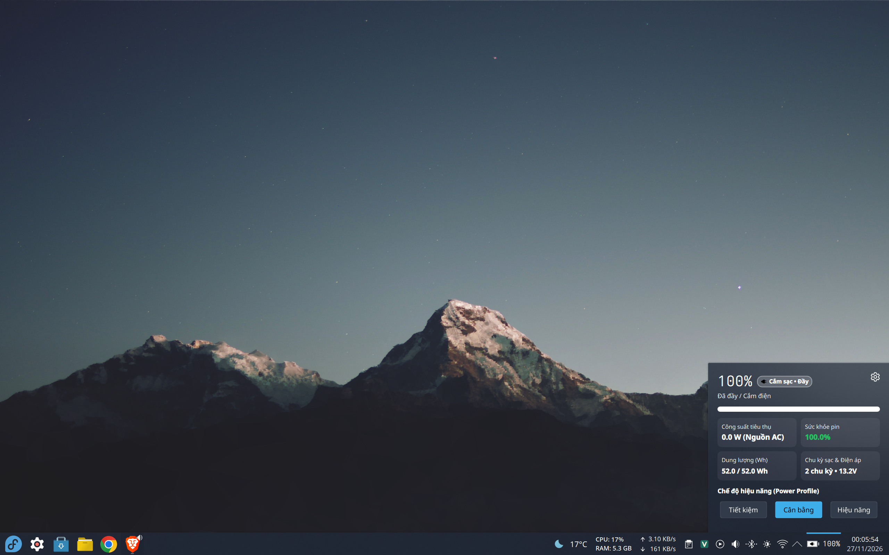
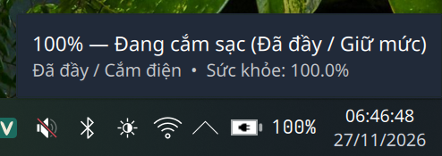
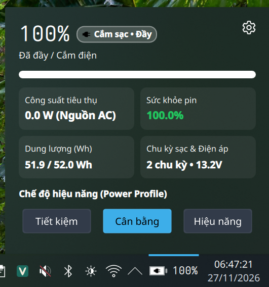

# Modern Battery Pill (KDE Plasma 6 Widget)

[English](README_en.md) | **Tiếng Việt**

Widget hiển thị pin dạng viên thuốc hiện đại cho KDE Plasma 6 với thông số công suất (W), sức khỏe pin, chu kỳ sạc và chuyển đổi nhanh Power Profile.

## Ảnh chụp màn hình / Screenshots



| Di chuột / Hover | Chi tiết / Popup |
| :---: | :---: |
|  |  |

## Tính năng chính / Features

- **Thanh pin dạng viên thuốc (Modern Battery Pill):**
  - Hiển thị mức pin trực quan với hiệu ứng chuyển động mượt mà; hỗ trợ chọn vị trí hiển thị % pin (**bên trong**, **phía trước** hoặc **phía sau** thanh pin).
  - Tùy chỉnh linh hoạt: bật/tắt ký hiệu `%`, núm đầu cực pin bên phải, tự động co giãn độ rộng theo nội dung hoặc cố định kích thước, chiều cao, bo góc và độ dày viền.
- **Biểu tượng sạc & cắm nguồn tùy biến (Charging & AC Plugged Icons):**
  - Tách riêng icon cho trạng thái **đang sạc** và **đang cắm nguồn AC** (mặc định dùng icon SVG [`icons/plug-horizontal.svg`](icons/plug-horizontal.svg) giữ nguyên màu gốc).
  - Hỗ trợ preset có sẵn, tên KDE icon theme, ký tự/emoji, hoặc chọn file ảnh/vector tùy chỉnh (`SVG`, `PNG`, `WebP`, `ICO`...) kèm tùy chọn nhuộm màu icon theo màu chữ.
- **Tùy chỉnh kiểu chữ & màu sắc (Typography & Colors):**
  - Tùy chỉnh font chữ, cỡ chữ, độ đậm (`300`–`800`), in nghiêng và viền bóng chữ để tăng độ tương phản.
  - Cấu hình màu riêng cho từng trạng thái (bình thường, đang sạc/AC, pin yếu kèm ngưỡng cảnh báo %), màu nền thanh pin, màu viền và màu chữ.
- **Thông số pin chi tiết & Power Profiles:**
  - Popup hiển thị trạng thái nguồn, công suất sạc/tiêu thụ (`W`), thời gian ước tính tới đầy/còn lại, sức khỏe pin (`%`), dung lượng (`Wh`), số chu kỳ sạc và điện áp (`V`).
  - Tích hợp chuyển đổi nhanh chế độ hiệu năng (**Power Saver** / **Balanced** / **Performance**) trực tiếp qua D-Bus (`UPower` / `power-profiles-daemon`).
- **Song ngữ Anh / Việt (English & Vietnamese):**
  - Mặc định tự động nhận diện ngôn ngữ hệ điều hành, tự động fallback sang tiếng Anh nếu hệ điều hành dùng ngôn ngữ khác.
  - Có thể chọn thủ công Tiếng Việt hoặc English trong phần cài đặt.

## Cài đặt / Cập nhật / Gỡ bỏ

```bash
# Cài đặt lần đầu
./install.sh

# Cập nhật sau khi chỉnh sửa source (tự động khởi động lại Plasma Shell)
./update.sh

# Gỡ bỏ hoàn toàn widget và cấu hình đã lưu
./uninstall.sh
```

Hoặc dùng trực tiếp `kpackagetool6`:

```bash
kpackagetool6 --type Plasma/Applet --install .
kpackagetool6 --type Plasma/Applet --upgrade .
kpackagetool6 --type Plasma/Applet --remove com.duy.batterypill
```

## Ghi công & Giấy phép / Credits & Licenses

- **Widget License:** Copyright (C) 2026 [duynguyenvp](https://github.com/duynguyenvp) — [GNU General Public License v3.0 or later (GPL-3.0-or-later)](LICENSE).
- **Repository:** [github.com/duynguyenvp/kde-modern-battery-pill](https://github.com/duynguyenvp/kde-modern-battery-pill)
