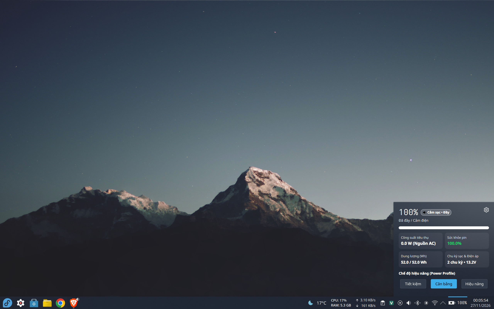
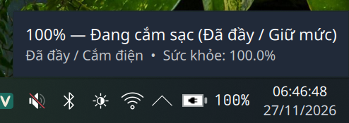
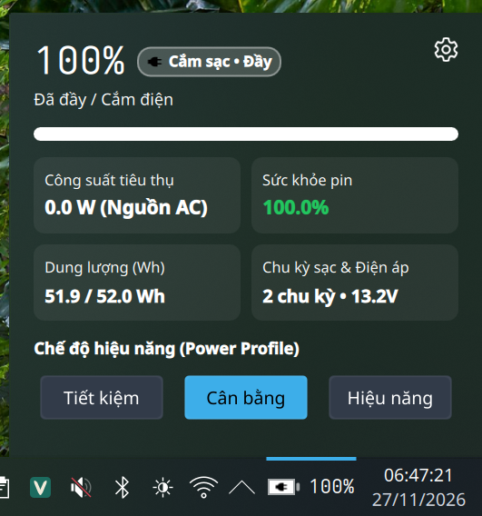

# Modern Battery Pill (KDE Plasma 6 Widget)

**English** | [Tiếng Việt](README.md)

A modern pill-shaped battery widget for KDE Plasma 6 displaying power draw/charging wattage (W), battery health, cycle count, and quick Power Profile switching.

## Screenshots



| Hover | Popup |
| :---: | :---: |
|  |  |

## Features

- **Modern Battery Pill Bar:**
  - Visually displays the battery level with smooth animations; supports placing the percentage label **inside**, **before**, or **after** the battery bar.
  - Flexible customization: toggle the `%` symbol and right-side battery terminal nub, auto-fit width to content or use a fixed size, and adjust height, corner radius, and border thickness.
- **Customizable Charging & AC Plugged Icons:**
  - Separate icons for **charging** and **AC plugged (not charging)** states (defaults to the bundled SVG icon [`icons/plug-horizontal.svg`](icons/plug-horizontal.svg) preserving its original colors).
  - Supports built-in presets, KDE icon theme names, text/emoji characters, or custom image/vector files (`SVG`, `PNG`, `WebP`, `ICO`, etc.) with optional tinting to match text color.
- **Typography & Colors:**
  - Customize font family, font size, font weight (`300`–`800`), italic style, and text outline/shadow for improved contrast.
  - Configure individual colors for each state (normal, charging/AC, low battery with configurable threshold %), pill background, border, and text color.
- **Detailed Battery Info & Power Profiles:**
  - Popup displays power state, charging/discharging rate (`W`), estimated time to full/empty, battery health (`%`), energy capacity (`Wh`), charge cycle count, and voltage (`V`).
  - Built-in quick switching for performance modes (**Power Saver** / **Balanced** / **Performance**) directly over D-Bus (`UPower` / `power-profiles-daemon`).
- **Bilingual (English & Vietnamese):**
  - Automatically detects the OS language by default and falls back to English for other languages.
  - Manually switchable between English and Vietnamese in the widget settings.

## Installation / Update / Uninstall

```bash
# First-time installation
./install.sh

# Update after modifying source (automatically restarts Plasma Shell)
./update.sh

# Completely remove widget and saved configuration
./uninstall.sh

# Build a .plasmoid package
./build.sh
```

Or use `kpackagetool6` directly:

```bash
kpackagetool6 --type Plasma/Applet --install .
kpackagetool6 --type Plasma/Applet --upgrade .
kpackagetool6 --type Plasma/Applet --remove com.duy.batterypill
```

## Credits & Licenses

- **Widget License:** Copyright (C) 2026 [duynguyenvp](https://github.com/duynguyenvp) — [GNU General Public License v3.0 or later (GPL-3.0-or-later)](LICENSE).
- **Repository:** [github.com/duynguyenvp/kde-modern-battery-pill](https://github.com/duynguyenvp/kde-modern-battery-pill)
